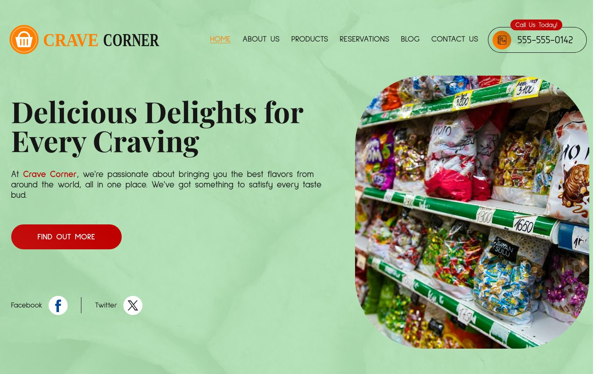
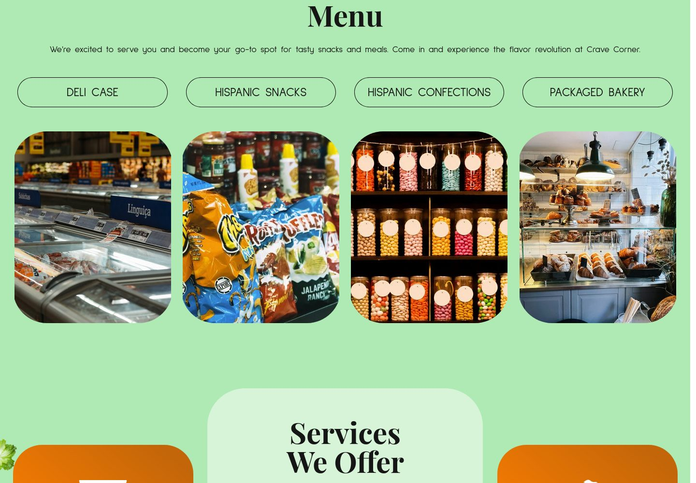
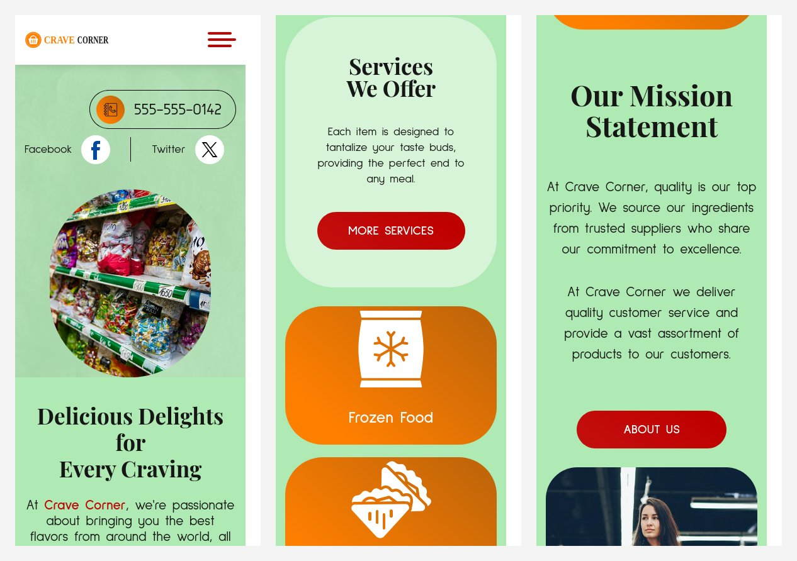
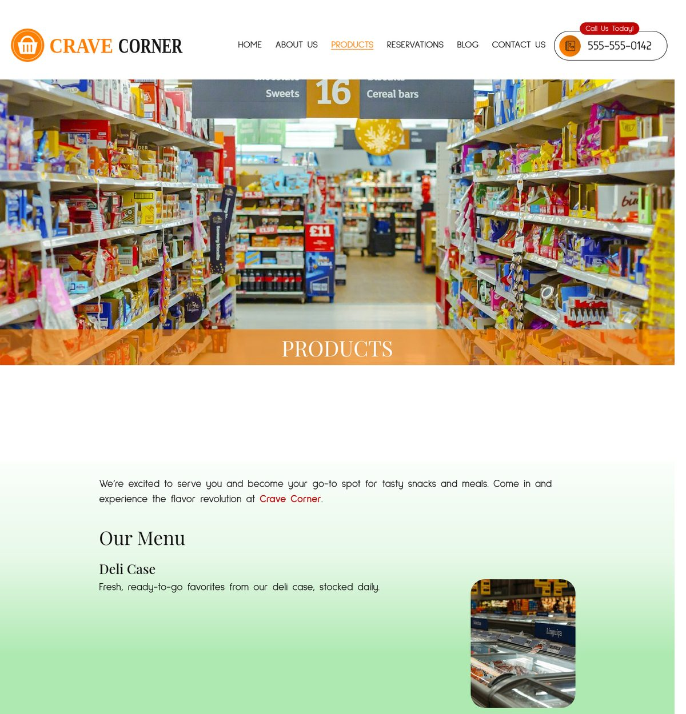

# Crave Corner — WordPress Theme for a Snack & Grocery Shop

A classic WordPress theme for a neighborhood snack and grocery shop: an animated, image-led homepage,
product menu, services, reservation and contact forms, and a blog. The brand ("Crave Corner"), address,
phone number and email are fictional.

**[▶ Live demo in WordPress Playground](https://playground.wordpress.net/?blueprint-url=https://raw.githubusercontent.com/Rosvie/wp-theme-grocery/main/dev/blueprint.json)**:
runs a full WordPress site with the theme and demo content in your browser. Nothing to install;
it takes about 20–30 seconds to boot.



| Menu and services | Mobile |
| --- | --- |
|  |  |

| Products page | Contact page with form |
| --- | --- |
|  |  |

<details>
<summary>Full homepage</summary>


</details>

## Highlights

- **Homepage sections:** hero with image slider, intro with a rotating product slider, menu categories,
  "Services We Offer" tiles that reveal a photo on hover, mission statement, quarterly-specials teaser,
  a "Send Us a Message" form and a contact block with an embedded map.
- **Scroll animations:** sections fade and zoom in as they scroll into view (WOW.js + Animate.css).
- **Responsive layout:** desktop, tablet and phone breakpoints, with an off-canvas mobile menu.
- **Forms:** contact, reservation, referral and job-application forms, loaded in an auto-height iframe
  with the `[form src="contactForm_Fullname"]` shortcode. A **demo mode** (on by default) validates input
  and shows the thank-you message without emailing anyone.
- **Standard WordPress:** pages, menus (primary and footer locations), featured-image banners on inner
  pages, blog index and single posts, search and 404 templates.
- **PHP 8.3 compatible:** runs with no errors, warnings or deprecation notices under `WP_DEBUG`.

## Work done on this theme

- Ported the homepage design from a static HTML mockup into the WordPress template parts in `includes/`.
- Upgraded the code for PHP 8: replaced the removed `create_function()`, fixed the form framework
  (hard-coded WordPress paths, a recursion crash, undefined variables, PHP 8 parameter-order
  deprecations) and replaced `get_page_by_title()`, deprecated in WordPress 6.2.
- Added the missing `header.php`, `footer.php`, `sidebar.php`, `comments.php` and `home.php`, so blog
  archives and posts render inside the theme instead of falling back to bare markup.
- Fixed layout bugs on tablets and phones (overlapping service tiles and map, a hidden mobile logo) and
  added inner-page layout styles.
- Added a demo mode for the forms, a demo-content seed script, a Docker setup and a Playground blueprint.

## Run it locally

Requires Docker.

```bash
git clone https://github.com/Rosvie/wp-theme-grocery.git crave-corner
cd crave-corner/dev
./setup.sh
```

This starts WordPress + MariaDB, installs WordPress, activates the theme and loads the demo pages,
posts and menus. Open <http://localhost:8080> (admin: `/wp-admin`, `admin` / `admin`; for local use
only). Use another port with `WP_PORT=8090 ./setup.sh`. Stop with `docker compose down` (add `-v` to
wipe the database).

To use the theme on an existing site, copy this folder into `wp-content/themes/` (any folder name works),
activate it, and optionally load the demo content with
`wp eval-file wp-content/themes/<folder>/dev/seed.php`. A clean theme zip without `dev/`, `docs/` and
this README can be built with:

```bash
git archive --format=zip --prefix=crave-corner/ -o crave-corner.zip HEAD
```

## Sending real email from the forms

The forms run in demo mode by default. To send real messages, edit `forms/config.php`:

1. Set `FORM_DEMO_MODE` to `false`.
2. Add your Google reCAPTCHA v2 site key and secret key (`$recaptcha_sitekey`, `$recaptcha_privite`).
3. Set the recipients (`$to_email`) and sender (`$from_email`).

Never commit a real secret key; keep it in a local, untracked copy of the config.

## Project structure

```
├── style.css, css/        Theme styles (css/media.css holds the responsive breakpoints)
├── functions.php          Theme setup, menus, shortcodes ([form], [page_intro], [short_title])
├── page.php, home.php …   WordPress templates
├── includes/              Template parts: head, header, nav, banner, homepage sections, footer
├── forms/                 Form framework: templates, controllers, demo-mode mail sender
├── js/                    Sliders, mobile menu and animation scripts
├── images/                Theme images and icons (logo.svg, footer-logo.svg)
├── index.php              Static HTML mockup of the original design (reference only)
├── dev/                   Docker setup, Playground blueprint and demo-content seed script
└── docs/screenshots/      README images
```

## Photo credits

All photos are from [Unsplash](https://unsplash.com) under the [Unsplash License](https://unsplash.com/license)
(free to use, modify and use commercially; attribution appreciated). They were cropped and resized for the
theme, and the hero background is a green-tinted version of the chips photo.

| File | Photographer |
| --- | --- |
| `images/slider/1.jpg`, `images/slider/rslides/1.jpg` | [Di Weng](https://unsplash.com/photos/2lu4hpLgBxY) |
| `images/slider/2.jpg`, `images/slider/rslides/2.jpg` | [paws and prints](https://unsplash.com/photos/6vmVcLvyeO0) |
| `images/slider/3.jpg`, `images/slider/rslides/3.jpg` | [Andy Li](https://unsplash.com/photos/RndRFJ1v1kk) |
| `images/side-img1.jpg` | [Seongho Jang](https://unsplash.com/photos/v3cQex9UX7A) |
| `images/side-img2.jpg` | [Raphael Nogueira](https://unsplash.com/photos/Znvxeud6sDc) |
| `images/side-img3.jpg` | [Karsten Winegeart](https://unsplash.com/photos/4jUffy7Sx2w) |
| `images/btm1-img1.jpg` | [Eduardo Soares](https://unsplash.com/photos/XRqTzBvCYEQ) |
| `images/btm1-img2.jpg` | [Ishaq Robin](https://unsplash.com/photos/x8A07rwQ09I) |
| `images/btm1-img3.jpg` | [Viktor Talashuk](https://unsplash.com/photos/BvFNArgW7EQ) |
| `images/btm1-img4.jpg` | [Fabio Traina](https://unsplash.com/photos/6i6NJgCJ8k0) |
| `images/btm2-img1.jpg` | [Eduardo Soares](https://unsplash.com/photos/_TWuQeTq-GY) |
| `images/btm2-img2.jpg` | [Eiliv Aceron](https://unsplash.com/photos/mAQZ3X_8_l0) |
| `images/btm2-img3.jpg` | [chansu shin](https://unsplash.com/photos/YjjAU8eQjDc) |
| `images/btm2-img4.jpg` | [Kirsten Drew](https://unsplash.com/photos/n49BjsFf5dI) |
| `images/btm3-img.jpg` | [Vitaly Gariev](https://unsplash.com/photos/6aBRyZGtdeY) |
| `images/btm4-img.jpg` | [Emiliano Vittoriosi](https://unsplash.com/photos/ONQ86GlHs3c) |
| `images/slider/nh-banner.jpg` | [Jack Lee](https://unsplash.com/photos/IH65r4HEQWQ) |
| `images/bnr-bg.jpg` | [Mustafa Bashari](https://unsplash.com/photos/S4PC4SeKwKg) |

Product packaging that appears in the photos belongs to its respective brands and is shown incidentally.

## License

GPL-2.0-or-later, like WordPress itself (see `license.txt`).
